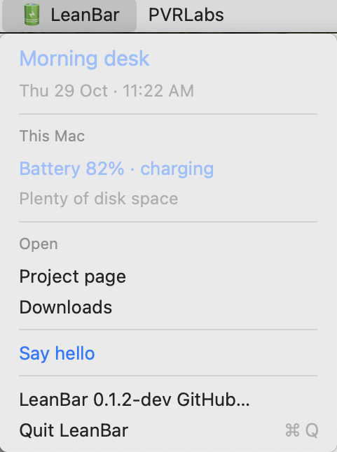

# LeanBar

A light, low-resource menu-bar host with a simple philosophy: **keep your
scripts, keep the host small**.



LeanBar is an almost drop-in replacement for SwiftBar when your menu uses its
small supported subset. A script prints status and actions; LeanBar turns them
into a native macOS menu. Use it as a small control panel for services, apps,
scheduled jobs and logs, with the management logic staying in your scripts.

One script. One native menu. Plain text in the menu bar. No marketplace,
settings UI, animation, or third-party libraries. The host uses Swift + AppKit;
a short-lived Python helper bounds command execution.

## Install

Requires macOS 13 or newer. The app supports Intel and Apple Silicon.

```sh
brew install --cask pvrlabs/tap/leanbar
open /Applications/LeanBar.app --args /Applications/LeanBar.app/Contents/Resources/menu.sh
```

Homebrew installs Python 3 for the command helper. Pass an absolute executable
script path instead of the bundled example to use your own menu.

The app is ad-hoc signed and not notarized. If macOS blocks the first launch,
allow LeanBar in **System Settings → Privacy & Security → Open Anyway**,
then rerun the launch command if needed.

See the [installation guide](docs/install.md) for a `curl` download with checksum
verification, custom-script launch commands, upgrades, and uninstall steps.

## Build and run

Requires macOS, Apple's Swift compiler/Command Line Tools, and
Python 3 (Homebrew Python is preferred; `/usr/bin/python3` from the developer
tools is the fallback). Builds for the local
machine. There are no packages to download.

```sh
./build.sh
open .build/LeanBar.app --args "$PWD/examples/menu.sh"
```

Use `./build.sh --universal` to build for both Intel and Apple Silicon with a
macOS 13 minimum. The app includes the MIT license and example menu in
`Contents/Resources/`.

`examples/menu.sh` is a live desk: a greeting, the time, power, machine details,
free disk, and a few actions. It shows real details by default; set
`LEANBAR_DEMO=1` for generic machine, battery, and disk details.
`examples/menu-demo.sh` launches that anonymized demo mode for screenshots.

To reuse an existing script, pass its absolute executable path:

```sh
open .build/LeanBar.app --args /absolute/path/to/menu.10s.sh
```

The default is refresh on opening and after actions, with no periodic work.
An optional interval in seconds enables periodic refresh:

```sh
open .build/LeanBar.app --args /absolute/path/to/menu.10s.sh 10
```

The filename's SwiftBar interval is not interpreted. Check the supported format
below before switching. For login startup, use a user LaunchAgent whose
`ProgramArguments` contain the app's `Contents/MacOS/LeanBar`, the producer's
absolute path, and optionally the interval. The app needs those arguments;
opening it without a producer does not configure a menu. Quit the old host to
avoid duplicate menus. The local build is ad-hoc signed, not notarized.

## Script format

LeanBar accepts a deliberately small flat subset of SwiftBar output. Your
existing script can work unchanged if it stays within this subset:

```text
title=🔋 LeanBar
---
Service: running | color=green size=13
Open dashboard | shell=/usr/bin/open param1=http://127.0.0.1:8765 terminal=false
Restart service | bash=/absolute/path/to/control.sh param1=restart terminal=false refresh=true
---
Last success: 09:00 | size=12
```

- The optional first-line `title=TEXT` directive sets the menu-bar caption. It
  is metadata, not a menu item. Without it, LeanBar displays `LB`, preserving
  existing scripts whose first line is ignored. An empty title also uses `LB`.
  Captions use native plain-text rendering and are limited to 16 characters;
  images, custom fonts, and rich text are not loaded. The second line must be
  `---`.
- Flat labels, `---` separators, `color` and `size` are supported. Colors:
  orange, gray, red, green, blue; other names use the system label color.
  Sizes are clamped to 9–24 points. Labels without commands are disabled.
- `bash` and `shell` both identify an absolute executable, run directly.
  Scripts need executable permission and a shebang. `terminal=false` is required.
- `param1`, `param2`, … are consecutive argv values. Keys must use canonical
  positive integers, without leading zeros or signs. Whitespace separates
  fields; single/double quotes and backslash preserve spaces and literals.
  Shell expansion is never performed. Duplicate and unknown fields fail the
  snapshot. Avoid literal pipes and newlines in row labels.
- `refresh` is accepted for reuse; actions always request a refresh.

This is not full SwiftBar compatibility: no submenus, cycling headers, images,
plugin discovery, terminal actions, environment metadata, or filename scheduling.
Run a read-only producer through the parser before switching:

```sh
./examples/menu.sh | .build/LeanBar.app/Contents/MacOS/LeanBar --check
```

## Quiet refresh, bounded commands

Opening shows the cached menu and requests fresh status. Each successful refresh
updates the caption and full menu immediately, including labels, actions and
separators while open. A failed refresh preserves the last successful caption.
Each action item carries the arguments of its displayed command. Background
refreshes are quiet. Queued/running actions show progress, and failures remove
stale actions immediately.

Commands run off the UI thread, one at a time. Explicit actions queue ahead of
coalesced refresh requests. Identical argv cannot be submitted again while
queued/running; up to sixteen distinct actions can wait. Each invocation has a
five-second timeout and a combined 256 KiB output cap. The helper cleans up the
child process group when the invocation finishes. Long jobs should be handed
off to a service manager, not left running as helper descendants. Run trusted
local scripts: menu commands execute with your user permissions.

## Resource philosophy

Implement only what a useful menu needs. Avoid continuous polling when a fresh
snapshot on opening is sufficient. Keep service lifecycle and collection in
existing scripts and tools.

In an early local comparison, the native host's physical footprint was roughly
10–12 MB versus 59 MB for SwiftBar. Those are short observations from one setup,
not guaranteed limits or a new benchmark of this packaged build. Script processes
have their own temporary cost. The goal is low retained memory and little idle
work, with a small implementation that is easy to understand.

## Verification

```sh
./build.sh
python3 tests/check.py
python3 tests/ui-smoke.py
python3 tests/ui-smoke.py --races
```

The GUI checks require a logged-in macOS desktop and permission to launch GUI
processes. They use harmless temporary fixtures, including literal argv,
refresh/action overlap, duplicate suppression, menu cycles and failure recovery.
Build artifacts and test results remain under ignored `.build/`.

GitHub Actions builds the universal app, verifies its signature, and runs the
noninteractive tests on Intel and Apple Silicon on pull requests and pushes to
`main`. Interactive menu checks remain local.

## Scope and license

A small personal utility shared as-is. Fixes are occasional; there is no active
feature roadmap. Keep changes small and motivated by real menus. Cross-platform
support is a future direction; macOS is the only implemented platform.

See [releasing](docs/releasing.md) for the short manual release process.
Release history is in [CHANGELOG.md](CHANGELOG.md); contributor principles are in
[AGENTS.md](AGENTS.md).

[MIT](LICENSE) © 2026 PVRLabs.
